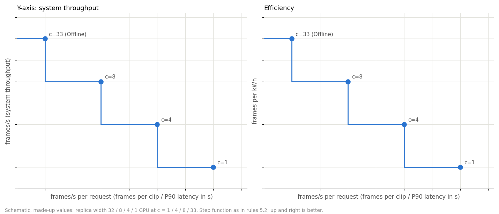

# Text-to-video benchmark: closing the client gaps

Status: proposal · Scope: this repository only.

> **Rules basis.** MLPerf Endpoints v1.0 rules on `endpoints_policies` `main` @
> `4ba8224` (2026-10-16):
> [`endpoints_rules.md`](https://github.com/mlcommons/endpoints_policies/blob/4ba8224/endpoints_rules.md)
> and
> [`endpoints_submission_rules.md`](https://github.com/mlcommons/endpoints_policies/blob/4ba8224/endpoints_submission_rules.md).
> §4.5 is marked tentative and §6.2, §6.4 and §6.5 are marked example values.

This document covers what the client needs so a text-to-video (T2V) workload,
WAN 2.2 with 248 prompts and 1 video file per response, can produce valid
Endpoints points, and the rule changes T2V needs from the WG.

## 0. Done in this change

- **Dataset and model entry.** The 248-prompt dataset and the `wan-2.2-t2v-a14b`
  model (BF16 VBench reference 70.48 on a 0-100 scale, gate 0.99 x 70.48 =
  69.78) in `config/rulesets/mlcommons/`. `VBenchScorer` reports on the same
  scale.
- **No tokenizer for video responses.** For `api_type: videogen`,
  `setup_benchmark` sets `tokenizer_name = None` and rejects a tokenizer
  override (`commands/benchmark/execute.py:572-580`), so the video path in
  `response_output` is never counted as tokens.
- **Sample order.** `RuntimeConfig.sample_order` (`config/schema.py:648`) lets
  performance runs use `with_replacement`, as §6.5 requires (without replacement
  is enough for T2V, see §3).
- **Point config.**
  `examples/09_Wan22_VideoGen_Example/endpoints_point_wan22.yaml` and the
  commands for each point in the example README.
- **Cohort checker, video runs.** The `2026-10-C1` cohort catalog has a
  `wan-2.2-t2v-a14b` entry with `frames_per_sample: 81`. A run's `system_tps` is
  `qps` x frames per clip, in frames/s (CL-F1). Video points skip the token and
  TPOT checks and are checked on a positive P90 latency instead (CL-F4,
  `derived.token_output`). `point_accuracy_vbench_gate` fails a VBench score
  under 0.99 x 70.48 = 69.7752 (CL-F5), and `point_sample_count_floor_wan22`
  fails a run that completed fewer than the 248 prompts (§12). The cohort is not
  a T2V cohort: the entry and rows ride the existing one until the WG rules.

## 1. Point set

The proposed point set is **4 + 1**: one point in each of the 4 standard §5.4
regions, each with an accuracy run, plus Offline. Today's rules ask for 8
points, or 7 when the `C_max` point is elected as Offline (§5.3); §3 asks the WG
for 4 + 1.

The regions come from `C_min` and `C_max` (§5.4, §5.5):

- **`C_min`** is the lowest submitted concurrency, between 1 and 32, unless
  `system_desc.json` sets `c_min_override`. Ultra Low is 1 to `C_min`.
- **`C_max`** is declared by the submitter and must be above 32. The High region
  ends at `C_max`, and §5.7.2 checks Offline against the point at `C_max`, so
  the top point sits at `C_max`.
- Low, Medium and High split `C_min` to `C_max` into three equal parts in log
  space. Any concurrency inside a region is allowed (§5.3).

Two choices on 32 GPUs, with `C_min = 1`. Each pick matches a replica count:

| Point                   | `C_max = 33`      | `C_max = 64`      | Replicas on 32 GPUs |
| ----------------------- | ----------------- | ----------------- | ------------------- |
| Ultra Low               | 1                 | 1                 | 1 x 32 GPU          |
| Low                     | 4 (region 2-4)    | 4 (region 2-5)    | 4 x 8 GPU           |
| Medium                  | 8 (region 5-11)   | 8 (region 6-17)   | 8 x 4 GPU           |
| High = `C_max`, Offline | 33 (region 12-33) | 64 (region 18-64) | 32 x 1 GPU          |

- **33** is the smallest legal `C_max`; one server always holds 2 requests.
  **64** puts 2 requests on every server, a clean saturation point. Both need
  1200 s (§6.2). A top point at 32 is not possible while §5.7.2 anchors Offline
  at `C_max`.
- **Offline** is the elected `C_max` point (§5.7.2 Option 2), declared in its
  `point.yaml`, or a dedicated run (Option 1) with concurrency at least `C_max`
  and throughput at least 0.98 x the `C_max` point.
- **Accuracy** is one pass over the 248 prompts at each region point; an elected
  Offline shares the `C_max` point's run.
- **Replica width may differ per point** (§4.5.3). The curve shows a trade-off
  only when it does (§2).

## 2. Metrics

Proposed, pending rule text. The unit of output is a **frame** of generated
video. A WAN 2.2 clip is 81 frames, so the metrics do not depend on clip length.

|                            | LLM (v1.0)                                            | T2V                                                        |
| -------------------------- | ----------------------------------------------------- | ---------------------------------------------------------- |
| Y-axis (system throughput) | tokens/s (`system_tps`)                               | frames/s: completed clips x frames per clip / elapsed time |
| X-axis (per user)          | tokens/s/user (`tps_per_user` = `1000 / tpot_p90_ms`) | frames/s per request: frames per clip / P90 latency in s   |
| Efficiency                 | tokens/s per provisioned kW (`system_tps_per_kw`)     | frames per kWh: frames/s x 3600 / provisioned kW           |
| Latency                    | `ttft_p90_ms`                                         | `latency_p90_ms`, request to response                      |

- **X-axis.** Higher is better, like tokens/s/user. It is the same idea as
  agentic `e2e_avg_interactivity`: output over end-to-end time. A value equal to
  the video's fps (16 for WAN 2.2) means real time.
- **Efficiency.** Provisioned power, per point, like `system_tps_per_kw`. Frames
  per kWh keeps the value well above §4.5's one decimal.
- **Across benchmarks.** Fair within one benchmark. Across benchmarks only at
  the same resolution.
- **What makes the curve meaningful.** If a replica serves one request at a
  time, per-request speed stays the same until every replica is busy, and above
  that only queueing grows. The curve shows a trade-off only when the replica
  width changes per point (wide for speed, narrow for throughput). `point.yaml`
  should record the replica size and count.

  

  Schematic with made-up values: the replica width changes per point (32, 8, 4,
  then 1 GPU at concurrency 1, 4, 8 and 33 on a 32-GPU system). As in rules §5.2
  the curve is a step function.

- **Client side.** Nothing new to measure: the report has `qps` (clips/s) and
  the latency percentiles; frames per clip comes from the benchmark definition.

## 3. Rule changes for the WG

- **Streaming (§6.5, §9.1).** Fixed-concurrency runs must stream, and a video
  response cannot, so §9.1 flags every T2V point. Proposed for §6.5: "Applies to
  benchmarks with token-streamed text output. Benchmarks whose responses are not
  token streams (for example text-to-video) are exempt, and TTFT and TPOT are
  not reported for them."
- **Sample order (§6.5).** §6.5 asks for performance prompts drawn with
  replacement. For T2V, multiple passes without replacement, with salting, cover
  every prompt equally and are enough. Proposed: allow `without_replacement` for
  T2V performance runs.
- **Point and accuracy count (§5.3, §9.1).** The 4 region points plus Offline as
  the minimum, with `N` = 4 accuracy runs, plus one for a dedicated Offline run.
- **Offline anchor (§5.7.2).** Define Offline against the highest-concurrency
  point, not a point at exactly `C_max`. Then 1, 4, 8, 32 on 32 GPUs is a valid
  set, with one request per server at the top point and a 600 s minimum.
- **Steady state (§4.4).** The §4.4 window needs token streams, which video
  responses do not have, so T2V reports the whole-run result (the §4.4
  fallback). The whole run includes the ramp-up and drain rounds, which lower
  the reported throughput, most at high concurrency. A round-trimmed window
  would leave them out (CL-B1).
- **Metric consistency (§9.1).** It requires a TPOT distribution, which a video
  run does not have; it needs a video form.
- **Metrics and power unit (§4.1, §4.5).** As in §2.

## 4. Running a point

The example README has the commands. Each point issues a multiple of the 248
prompts (§6.4), drawn with replacement (§6.5), enough to meet the §6.2 minimum
duration: 600 s at concurrency 1-32, 1200 s above. After the run:

- **Check `n_samples_failed == 0`.** Failed samples count as completed
  (`metrics/report.py:294`), so fast failures inflate `qps`.
- **Use `max_issue_duration_ms` only as a runaway guard.** A binding cap stops
  the point short of its sample count and breaks §6.4.
- **Declare warmup in `point.yaml` (§6.3.3).** The server warms up at startup;
  list that under `initialization_steps`. A client warmup (`warmup.enabled`)
  needs `warmup.salt`, because the accuracy and performance prompts are the same
  file (§6.3.1).
- **Keep `model_params.name` set to the served model name.** When it is unset,
  the client fills it from `submission_ref.model` (`config/schema.py:1230-1231`)
  and sends the slug to the server.

## 5. Pending work

A test upload of a 4-point end-to-end run (concurrency 1, 4, 8, 33, the last
elected as Offline), packaged with
`examples/09_Wan22_VideoGen_Example/package_submission.py` and checked against
the `2026-10-C1` cohort (`python -m inference_endpoint.validation`), left these
open once the video handling in §0 landed (the checker had refused the upload
for a missing `system_tps`, failed the token checks at every point and had no
VBench gate):

| #     | Checker result                                                                                                   | Change                                                                                           | Depends on    |
| ----- | ---------------------------------------------------------------------------------------------------------------- | ------------------------------------------------------------------------------------------------ | ------------- |
| CL-F2 | `pareto_point_count_min`: 4 points against 7                                                                     | Per-benchmark minimum in `Pareto.point_count_min` (`validation/submission.py`)                   | WG §5.3       |
| CL-F3 | `pareto_accuracy_run_count`: 4 against 5, with Offline elected                                                   | An elected Offline shares the `C_max` run, so require 4, plus 1 only for a dedicated Offline run | WG §4.3, §5.3 |
| CL-F6 | A top point at 32 is refused: `C_max` must be above 32                                                           | Anchor Offline on the highest point                                                              | WG §5.7.2     |
| CL-B1 | Steady state: today `steady_state_profile` (`commands/benchmark/pipeline.py:99`) needs streaming and a tokenizer | Trim one round of completions at each end                                                        | WG §4.4       |

Passed: run completeness, seeds, durations, region coverage, the elected
Offline, warmup (declared as zero client warmup), and accuracy presence. The
submitter still fills in `division`, `model_precision`, `shared_src`,
`shared_docs` and `system_power.json`.

Running the checker at this change on such an upload also reports what the
submitter, not the rules, has to fix:

- **Disclosures.** `point_disclosure_complete` fails until each `point.yaml`
  carries `division`, `model_precision`, `shared_src` and `shared_docs`;
  `package_submission.py` does not fill them in.
- **VBench scale.** A run scored by a client older than this change reports
  VBench on a 0-1 scale, so `point_accuracy_vbench_gate` fails it. Score the
  videos with this client, which reports 0-100.
- **Power.** `system_power_declared` warns until `system_power.json` gives the
  provisioned power that frames per kWh needs.

Every code task carries tests; `AGENTS.md` sets > 90% coverage.
