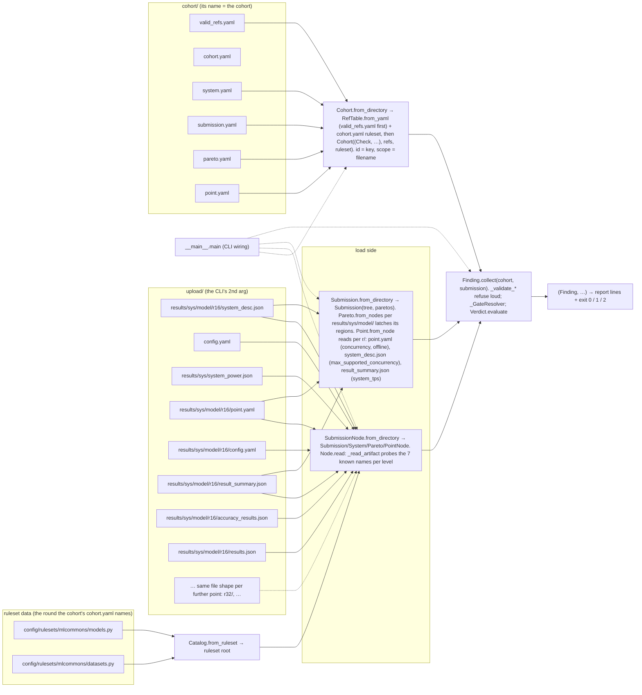

# Validation submodule - what happens under the hood

Implementation notes for `inference_endpoint.validation`: the module map, the
row and operator model, the tree walk, the derivation sources, and the runner's
mechanics. The user-facing how-to is [`README.md`](README.md); this page is for
maintainers and reviewers, not for check authors.

## 1. Module map

Thirteen modules. Each entry is the role first, then the names you will grep
for.

- **`__main__.py`** — the user-facing CLI. `main(argv) -> exit code` (argparse)
  wires `Cohort.from_directory` + `Catalog.from_ruleset` (the ruleset the
  cohort's `cohort.yaml` names) + `Submission.from_directory` +
  `Finding.collect`; `--audit` prints holds too. The report marks
  `OK`/`FAIL`/`WARN`, prints `<id> ran at N instance(s)` per check and
  `NEVER-RAN <id>` on stderr at zero, both worded from the check's own
  `CheckRun` (its `when` gate, its `needs` chain, or both), and a closing
  `N finding(s), F failing (B blocking)` summary. Exit codes: `0` everything
  applicable held or failed only at `warn`; `1` a failing `fail` finding; `2`
  cohort or submission refused before any check ran.

- **`check.py`** — the cohort side.

  - `Check` is a block's typed shape: `id` and `scope` are synthesized from the
    scope file and the mapping key; `description`, `rule`, `severity`,
    `fix: str | None`, `needs`, `when` and `assert` come from the YAML.
    `_decode_row` picks `Compare` vs `Aggregate` by `aggregate` presence.
  - `_validate_row_ref` holds the scope-depth rule: `derived.<name>` must name a
    derivation, and only from a pareto- or point-scoped file; `regions.*` only
    `regions.coverage`/`regions.by_kind.<kind>`, likewise; `ruleset.*` is the
    catalog's own data; a row may not name a finer scope's facts than its own
    file holds.
  - `_checked_ref` runs `_validate_row_ref`, then the cohort ref table's
    `validate_names`/`annotate` — the one place a row's names get checked.
  - `Cohort.from_directory` loads `valid_refs.yaml` first (via
    `RefTable.from_yaml`), then the four scope files, each an id-keyed mapping;
    `cohort.yaml`, when present, is read as the manifest: the `ruleset` name it
    declares, or `ruleset_dir` naming a bundled `ruleset/` catalog directory
    (`Catalog.from_directory`). Every row's refs run through
    `check._checked_ref` via `map_refs`. Refused with `ValueError`: a file
    outside the known names, a missing ref table, an in-body `id`/`scope`, a
    duplicate `id`, a manifest that is not a manifest.
  - `Cohort(checks, refs, ruleset, ruleset_dir)` carries `Cohort.refs` — the
    `RefTable`, `None` for a hand-built `Cohort((check, ...))` — plus the
    manifest's rule source: `Cohort.ruleset` (a registered name) or
    `Cohort.ruleset_dir` (a resolved catalog directory), each `None` without a
    manifest. `Severity` is the `warn`/`fail` wire-enum.

- **`compare.py`** — the row model and the verdict boundary.

  - `Compare` is the op row model (`Op`-driven arity; slots `left`/`right`; an
    `in` range literal `{lo, hi}` resolves to an `Interval`); `Aggregate` is the
    collection row (`__new__` aggregate dispatch; the
    `Count`/`Sum`/`Mean`/`Min`/`Max`/`AnyTrue`/`AllTrue` family; slots
    `over`/`value`). `map_refs`/`operands` is the rows' `Ref`-slot API, what
    cohort-load name checking drives.
  - `_operand`/`_missing_outcome` decide how an absent fact reads: one whose
    `Ref.default` the cohort ref table filled (e.g. `config.offline`) judges as
    that value, while presence rows see the key's raw absence; a missing
    `Ref.required` fact raises and becomes `Verdict.broken`, and a missing
    optional fact makes the row simply not hold (README, "Absent facts").
  - `Verdict.evaluate` is the boundary: `TypeError` becomes
    `incommensurable pair`, `ValueError`/`OverflowError` becomes
    `row failed to evaluate`; every failing verdict names both sides. Anything
    else propagates.

- **`operations.py`** — the `Op` family (12 ops) and `Predicate`.

  - Ops self-register on `Op(name)` via `__new__`: `Eq`, `Ne`, `Gt`, `Ge`, `Lt`,
    `Le`, `In`, `Matches`, `SameMultiset`, `Exists`, `Absent`, `NotNull`.
  - `Predicate(subject, target)` is the resolved-operand carrier; `target` is
    the resolved `right`, or the `Interval` a range test resolves to.
  - `Op.tolerant` is True on `Eq`/`Ne` only; `Compare._check_shape` rejects
    nonzero tolerances on non-tolerant ops.

- **`ranges.py`** — `Interval(lo, hi=None, lo_inclusive, hi_inclusive)`:
  bounded, unbounded or half-open, membership via `__contains__`, plus
  `Interval.for_accuracy_gate(reference_score, tolerance)` (Section 2.9.8's
  `score >= factor x reference`).

- **`regions.py`** — one pareto's Section 5.5 regions.

  - `RegionKind` is the wire-enum of the five `compute_regions` keys:
    `ULTRA_LOW_CONCURRENCY` (wire value `low_latency`, the Ultra Low Concurrency
    region), `LOW_CONCURRENCY`, `MED_CONCURRENCY`, `HIGH_CONCURRENCY`, `MARGIN`.
  - `Regions.for_pareto` derives one pareto's `C_max`/`C_min`
    (`c_min_override`-aware, Section 5.4's override validated);
    `Regions.for_bounds(*, c_min, c_max)` runs Section 5.5's reference algorithm
    verbatim, keyword-only.
  - `Regions.covers` and `Regions.coverage` answer membership;
    `C_MIN_LOWEST`/`C_MIN_HIGHEST`/`MARGIN_FACTOR` are the constants.

- **`tree.py`** — the submission tree and the read channel.

  - `Node` registers its kind subclasses via `__init_subclass__(kind=...)` and
    dispatches through `__new__`: `SubmissionNode`/`SystemNode`/`ParetoNode`/
    `PointNode`. `Node.scopes()` is the facts-projection map each ref namespace
    reads.
  - `StrictLoader` refuses duplicate keys, `<<` merge keys and all YAML aliases
    at parse time.
  - `_read_artifact` is the single bounded, symlink-safe byte channel (see
    "Notable engineering calls"): fd-anchored per node directory, `O_NONBLOCK`
    - `S_ISREG` refusing FIFO/socket/device artifacts instantly, a byte cap
      applied before decode (and charged to the tree budget before the size
      refusal: an oversized artifact is still a read), and `UnicodeDecodeError`
      funneled into `(value, error)`. An empty or non-mapping document reads as
      `(None, "<name> parse error: ...")`.

- **`refs.py`** — references and the cohort's ref table.

  - `Ref` is the row model's dotted reference. A ref's first segment is its
    namespace: `Ref.SCOPE_ROOTS` the four node scopes, `Ref.CHECKER_ROOTS` the
    checker-owned `derived`/`ruleset`/`regions`; `Ref.ROOTS` is their union and
    `from_string` gates on it. `resolve` is mapping-only: a resolved leaf is
    returned as-is, so a namespace's `Interval` is a value and never walked
    through. The `found`/`MISSING` grid tells absent from stored-null.
  - `RefTable.from_yaml` parses one cohort's `RefTable.FILENAME`
    (`valid_refs.yaml`; scope → document → fields) and refuses a `derived`/
    `regions`/`ruleset` top-level key (`is not a node scope`). Notes are
    cross-validated at load: a `default` and every allowlist value must match
    the declared type, and `required` cannot carry a `default` (a default
    answers the fact's absence). `validate_names` refuses a path naming no fact
    (`names no fact`, with a one-edit `typo_checks.near_match` hint) or stepping
    below a leaf fact (`is one leaf fact, nothing deeper`); a `dict` open
    subtree takes any deeper name. `annotate` fills
    `Ref.required`/`Ref.default`/ `Ref.type` from the leaf it names, and
    `resolve` reads a numeric path component against the key spelling the same
    number (`_key_for`), so a row naming `…tpot.percentiles.90` finds a block
    keyed `"90.0"` - the canonicalisation the submission checker applies to
    percentile keys.
  - `validate_values` checks one node's present values against its scope's
    declaration: `_check_values` walks declared-vs-carried and `_Fact.matches`
    types each leaf (`bool` is not `int`; `float` accepts ints), `allowlist`
    membership, and "a declared block must carry a block". A declared
    `int`/`float` leaf whose value is a numeric string reads as the number it
    spells (`_Fact.coerce`, exact spellings only) and the pass returns one note
    per decoding, which `Collected.coercions` carries to the report's `coerced:`
    lines. Absent facts go unchecked; `dict` subtrees stay open (an `allowlist`
    on a `dict` is refused: nothing to enumerate). The grammar's constants live
    on their users (`_Fact.VALID_TYPES`); the mapping form's reserved keys
    derive from `_Fact`'s own fields.

- **`typo_checks.py`** — the one one-edit name matcher (`near_match`: one
  insert/delete/substitute). It serves both hint paths:
  `RefTable.validate_names`'s declared fact names and
  `compare._near_namespace_misspelling`'s operand namespaces. Dependency-free so
  both may import it.

- **`sentinels.py`** — the shared `MISSING` sentinel. `value is MISSING` is the
  fact's absence, distinct from a stored null.

- **`catalog.py`** — `Catalog.from_ruleset` derives it from the registered round
  the cohort's manifest names (`models.py`/`datasets.py`);
  `Catalog.from_directory` reads a development `models.yaml`/`datasets.yaml`
  pair into the same plain dicts. `Catalog.scopes()` is the `ruleset` root's
  payload.

- **`submission.py`** — the typed submission side.

  - `normalize_offline` is Section 8.3's three-state `offline` normalization.
  - `Point` (frozen: `offline`/`concurrency`/`system_tps`/`system_desc`/`node`)
    and `Point.from_node`, which reads one `r<N>` run directory — `point.yaml`'s
    `concurrency`/`offline`, its own `system_desc.json`, and
    `result_summary.json`'s `system_tps` — refusing each missing, mistyped, or
    unrepresentable fact at load (a `NaN`/`Infinity` `system_tps`, or an integer
    no `float` can widen, would otherwise judge quietly or crash a derivation).
    A numeric string reads as the number it spells (`refs.decode_number`, the
    rule the ref table applies to its declared leaves). `Point.point_power_kw`
    derives `provisioned_power_kw x Y/N` (Section 4.5.2/4.5.3,
    2dp-rounded-once).
  - `Pareto` (frozen `system_desc` + ordered `points`) is one
    `results/<system>/<model>/` and the unit every policy derivation is per;
    `Pareto.from_nodes` latches that pareto's `regions` root on its tree node.
    Its methods: `offline_ordering` (Section 5.7.2's two clauses), `point_cap`
    (Section 5.6's `<= 32`), `point_count_min` (Section 5.3's 8-or-7),
    `accuracy_run_count_requirement` (Section 4.3's 5/4), `out_of_range_points`
    (Section 5.4's Concurrency-in-range row), `derived()` (the lazy
    `derived.<name>` facts-projection), and `_validate_shape`, which refuses
    shapes the derivations would trip on. Points must agree on their
    `max_supported_concurrency`/`c_min_override` by presence and typed value
    (`_shared_facts`), so a later run's `null` override cannot compare equal to
    a first run's omission.
  - `Submission` (frozen `tree` + `paretos`) is built by
    `Submission.from_directory(root, ruleset=...)` — one `Pareto` per
    `<system>/<model>`, refusing a `<system>` with no model directories and a
    `<model>` with no run directories (an empty system cannot hide from
    system-scoped checks); `pareto_at(node)` locates the pareto a tree node
    belongs to.

- **`runner.py`** — `Finding` (the audit-trail record: `check_id`/`severity`/
  `scope`/`node_directory`/`verdict`/`rule`), `Finding.collect` (whose phases
  are "The runner's cascade" below), and the record it returns: `Collected` (the
  findings + one `CheckRun` per check) and `CheckRun`'s state counts
  (`ran_at`/`gated_off`/`silenced`), what the report's `ran at N`/`NEVER-RAN`
  lines are worded from.

## 2. Row and operator mechanics

`Op` self-registers through
`__init_subclass__(name=..., slots=..., needs_found=..., tolerant=...)` and
dispatches through `Op(name)` — the same shape as `Node`'s kind dispatch. Arity
per op lives in one place (`Op.slots`); `Compare._check_shape` validates
`Compare`'s `right` field-presence against it, so `right: null` stays a legal
eq-against-null operand (the absent-vs-stored-null grid).

Two mechanics are worth spelling out:

- **Region membership is an `op: in` row** against `regions.coverage` or
  `regions.by_kind.<kind>`. The stub cohort's `concurrency_in_range` is the
  shape to copy (its `when` exempts a dedicated Offline run — §5.7.2's dedicated
  point is not a fixed-concurrency point):

  ```yaml
  when:
    - left: point.config.offline
      op: ne
      right: dedicated
  assert:
    - left: point.config.concurrency
      op: in
      right: regions.coverage
  ```

- **Tolerances are integer-exact where it matters.** `_close_to` compares
  integer pairs exactly (math.isclose's float coercion conflates distinct large
  integers), honors tolerances in integer arithmetic, and lands float tolerance
  math only for `eq`/`ne`, per `Op.tolerant`. Order ops (`gt`/`ge`/`lt`/`le`)
  have no tolerance semantics — there is no standard meaning of an ordered
  comparison under `abs_tol`.

## 3. Library entry (what `__main__.py` calls)

```python
from inference_endpoint.validation.check import Cohort
from inference_endpoint.validation.runner import Finding
from inference_endpoint.validation.submission import Submission

cohort = Cohort.from_directory(Path("my_cohort"))
submission = Submission.from_directory(Path("upload"))
collected = Finding.collect(cohort, submission)
collected.findings  # one per evaluated `assert` row (holds too)
collected.runs  # one `CheckRun` per check: ran_at/gated_off/silenced
```

`Submission.from_directory` reads the same artifacts the rows read — per `r<N>`
run directory, its `point.yaml`'s `concurrency`/`offline`, its own
`system_desc.json`, and its `result_summary.json`'s `system_tps` — and latches
one `Pareto.from_nodes` per `results/<system>/<model>/`, so the typed `Point`s
and what the rows read are one parsed projection, not two.

`SubmissionNode.from_directory(root, ruleset=..., regions=...)` stays the raw
tree entry for tests and rule authors.

## 4. Data flow

One CLI run: every file below is its own node, flowing through the code objects
above to the report. Rendered natively by GitHub, Typora and VS Code.



## 5. The runner's cascade and emission

`Finding.collect(cohort, submission)` returns a `Collected` record (the row
findings plus one `CheckRun` per check) and runs four phases, then the walk.

1. **Contract validation.** `_validate_points`, `_validate_artifacts`,
   `_validate_declared_values` and `_validate_ruleset_needs` fail loud wherever
   the walk cannot happen: no points, or a point without its node; an artifact
   that failed to parse (a corrupt file must never read as an absent fact and
   switch checks off); a present value its `valid_refs.yaml` declaration will
   not carry (one per-node `RefTable.validate_values` pass, whose numeric-string
   decodings come back on `Collected.coercions`); or a cohort naming the
   `ruleset` namespace the tree was built without (`derived`/`regions` are
   per-pareto and always present at their nodes). The rule behind all four:
   silence must never be the verdict. A `when` row that failed to evaluate is
   refused loudly for the same reason — `Verdict.broken` separates "judged
   false" from "could not be judged" — while an optional fact the upload never
   declared stays judgeable: the row reads false, and `compare._missing_outcome`
   keeps that case distinct (README, "Absent facts").

2. **Candidate validation.** `_collect_candidates(cohort)` validates `needs` id
   references against the cohort and refuses a `needs` cycle outright (the DFS
   over the candidate map is the cycle check). Both are load-level mistakes,
   identical for every submission; the walk below never decides differently by
   data.

3. **Gate resolution.** `_GateResolver` resolves every check's `needs` chain at
   each node into one `_CheckState`:

   | State            | Meaning                                                       |
   | ---------------- | ------------------------------------------------------------- |
   | `HOLDS`          | `when` applied there, its chains vouched, every `assert` held |
   | `FAILS`          | it ran there and at least one row failed                      |
   | `NOT_APPLICABLE` | `when` excluded the node — the check makes no claim there     |
   | `SILENCED`       | its own `needs` chain refused to vouch, so its rows never ran |

   A chain resolves same-or-ancestor scopes up the dependent node's chain and
   finer scopes over every such node in its subtree. An upstream **vouches**
   when it claims at least one of those nodes and `HOLDS` at each. So a
   `when`-gated upstream speaks for what it covers and is silent, not damning,
   elsewhere; one failing claim disavows the dependent there; and an empty claim
   set never vouches — an unverified premise never passes a dependent.

4. **Emission.** One `Finding` per `assert` row at each `when`-applicable node
   whose chain `HOLDS`, holds and failures alike (the report side filters
   `not verdict.ok` for the failure summary). A check's own failing rows never
   gate its own findings; only its dependents stay silent, per node.

## 6. Derivation formulas (verbatim-anchored)

Each formula below is anchored to the Endpoints Policy section it implements.

- **`Interval.for_accuracy_gate(reference_score, tolerance)`** —
  `[tolerance * reference_score, inf)`, Section 2.9.8's
  `score >= factor x reference`.

- **`Regions.for_bounds(*, c_min, c_max)`** — Section 5.5's `compute_regions`
  reference algorithm verbatim: the three concurrency regions split
  `log2(C_max - C_min) / 3` with round-half-to-even boundaries, and `margin`
  ends at `ceil(1.10 * C_max)`. Keyword-only and bounds-checked
  (`1 <= C_min <= 32`, `C_max > 32`, else a `ValueError` naming the Section 9.1
  rows). Matches Section 5.4's worked examples.

- **`Regions.for_pareto(system_desc, concurrencies)`** —
  `C_max = system_desc["max_supported_concurrency"]` (the field name verbatim,
  per the Max-concurrency-declared row). `C_min` is
  `system_desc["c_min_override"]` when the key is declared, else
  `min(concurrencies)` — Section 5.5's "C_min is derived from the submission
  points". Section 5.4 validates every declared override — `null` included ("All
  other values, including `null`, are rejected") — as a bool-free integer in
  `[1, 32]` equal to a submitted point's concurrency, else a `ValueError` naming
  Section 9.1's C_min-override row.

- **`Pareto.offline_ordering()`** —
  `system_tps(Offline) >= 0.98 * system_tps(C_max)` AND
  `concurrency(Offline) >= C_max` (Section 5.7.2's two clauses); `None` when
  `elected` or agentic.

- **`Pareto.point_cap()`** — `len(points) <= 32` per pareto, Offline counted
  (Section 5.6).

- **`Pareto.point_count_min()`** — `8` if a dedicated `offline` is declared
  (non-agentic), `7` otherwise (elected or agentic), Section 5.3's
  one-fewer-distinct-run derivation.

- **`Pareto.accuracy_run_count_requirement()`** — `5` if any `offline` is
  declared (non-agentic), `4` otherwise (agentic), Section 4.3's `N`.

- **`Pareto.out_of_range_points(regions)`** —
  `tuple(p for p in points if p.offline != "dedicated" and p.concurrency not in regions.coverage())`,
  Section 5.4's Concurrency-in-range row. A dedicated Offline point is exempt:
  Section 5.7.2 calls it not a fixed-concurrency point, and its `concurrency` is
  the performance dataset's cardinality (Section 5.7).

- **`Point.point_power_kw(provisioned_power_kw, engaged_nodes, provisioned_nodes)`**
  — `round(provisioned_power_kw * engaged_nodes / provisioned_nodes, 2)`,
  Section 4.5.2/4.5.3's `P_prov x Y/N`, rounded to 2dp once per Section 4.5's
  Units-and-rounding rule. Matches Appendix C's golden rows:
  `152.10 x 16/18 = 135.2` and `152.10 x 18/18 = 152.1`.

## 7. Known boundaries (deliberate, priced)

- **Fact names are cohort data; the namespaces are code.** What a row may name
  under `submission`/`system`/`pareto`/`point` is declared per cohort in its
  `valid_refs.yaml` (the shipped declarations draw on the policy's field tables,
  pinned `4ba8224dc746`), so a misspelled row dies at cohort load instead of
  silently gating a check off by omission. The namespaces themselves stay the
  checker's — the four scope names and the checker-owned ones — as do `derived`
  names (`DERIVATION_NAMES`), `regions` paths and `ruleset` keys. The price: a
  rule over a brand-new field first needs that field declared in the cohort's
  ref table, and a brand-new namespace or derivation still needs code. One
  caveat on the mapping form: a mapping is the annotated-leaf form when its
  `type` value is a type name and every key is reserved
  (`type`/`required`/`default`/`allowlist`), so `field: { type: int }` is a leaf
  while `field: { type: { ... } }` is a block (its `type` value is itself a
  mapping, not a type name).

- **Rows above a pareto cannot aggregate over points.** There is no
  `derived`/`regions` namespace above a pareto (both are per-pareto by
  construction), so a system- or submission-scoped row cannot count over points
  at all. Per-pareto aggregate rows (point-count-from-nodes, region-coverage
  counts, accuracy-run counting) await a points-collection in the row model.

- **Agentic shape is inferred from omission.** With no `offline` declaration,
  `point_count_min` and `accuracy_run_count_requirement` report the agentic 7/4.
  A non-agentic upload that forgot its declaration is indistinguishable from an
  agentic one at this layer.

## 8. Notable engineering calls (for reviewers)

- **Derivations are exposed as fields `Ref` reads, and that exposure is
  priced.** The `derived.<name>` names are exactly `offline_ordering`,
  `point_cap`, `point_count_min`, `accuracy_run_count_requirement` and
  `out_of_range_points` (the `_DERIVATION_METHODS` table, published as
  `DERIVATION_NAMES`). `Point.point_power_kw` and `Interval.for_accuracy_gate`
  stay **method-only**: their inputs (provisioned/engaged node counts; the
  per-model reference score and gate factor) are carried on no fact the rows can
  reach today, so they price into the rows that need them (the per-point
  denominator and accuracy-gate rows) together with the carries those rows
  bring. `Regions.covers`' row use is `regions.by_kind.<kind>` membership
  (`op: in`) — the shape the stub cohort in `tests/assets/cohorts/stub/` writes.

- **The strict loader refuses duplicate keys, `<<` merge keys and all YAML
  aliases.** Alias fan-out can re-walk shared subtrees exponentially, and silent
  last-wins keys hide data from the review.

- **A numeric string decodes where a declaration expects a number.** Writers
  stringify numbers: a hand-edited YAML quotes one, a dumper formats floats
  (`"90.0"`), and refusing a real value over its quotation marks would fail a
  conforming submission. A declared `int`/`float` leaf therefore reads exact
  numeric spellings, and every decoding is reported (`coerced:` on stderr), so
  the leniency is visible instead of silent. Partial spellings (`"512 kw"`),
  separators, non-finite text and every non-numeric declaration stay as they
  were, and nothing decodes without a declaration: an un-annotated `Ref` (a
  checker-owned namespace, a hand-built row) reads the artifact raw. The
  parser-enforced facts decode through the same rule, so a stringified
  `concurrency` is read once and identically by the parser and by the row.

- **`_read_artifact` is fd-anchored.** The node's directory opens
  `O_NOFOLLOW|O_DIRECTORY`, and the artifact opens by name relative to that fd
  with `O_NOFOLLOW|O_NONBLOCK`: neither a symlinked artifact (in-tree or out)
  nor a swapped name can redirect a read, and a FIFO/socket/device at an
  artifact name is refused instantly (`S_ISREG`: "not a regular file") instead
  of blocking on open. The bounded byte-read applies its cap **before** decode
  and funnels `UnicodeDecodeError` (a `ValueError`) alongside `OSError` into
  `(value, error)` — one channel where "nothing here aborts the run" holds for
  real. An empty document or a non-mapping root is refused in the same shape
  ("<name> parse error: ..."), so neither can read as an absent fact. Known
  residual: the walk traverses paths, not fds, end to end, so swapping an
  intermediate directory between traversal and the fd open is still a narrow
  race; `matches` patterns are compile-vetted literals at load, so a
  deliberately pathological authored pattern remains cohort-review surface, not
  upload surface.

- **`Verdict.evaluate` classifies what escapes a row's `_outcome`.** A
  `TypeError` (a genuinely incommensurable pair) becomes an
  `incommensurable pair` failing verdict naming both sides and the exception
  class; a deliberate `ValueError` fail-loud or an `OverflowError` becomes
  `row failed to evaluate` carrying its own message — never mislabelled as a
  type mismatch. The shape errors the derivations would trip over never reach
  here at all: `Pareto._validate_shape` refuses them at build.

- **One `MISSING` sentinel** (`sentinels.py`) is shared by `Node.read`,
  `Predicate` and the presence ops, so the absent-vs-stored-null grid is one
  rule, not a per-module pair of conventions.

- **Operand decode (`compare._decode_operand`) keeps the scalar rule** (a dotted
  string headed by a namespace = `Ref`) and is otherwise strict: a dotted scalar
  whose head is one edit from a namespace raises ("misspelled"), and every other
  dotted scalar raises too ("no ref namespace") — no guessing between reference
  and value. The alternatives stay explicit: a namespace-headed list of raw
  segments addresses keys that themselves contain dots (near-miss heads refused
  likewise), and `{"literal": ...}` is the intentional literal. `matches` is the
  one operator where that form is mandatory for `right` rather than intentional:
  `Compare._matches_right_is_explicit_literal` refuses anything else at load, so
  a regex is never mistaken for a dotted reference and a pattern is never
  authored as one. Presence ops (`exists`/`absent`/`not_null`) refuse a literal
  `left` at load — that asks whether a constant exists, which answers itself.
