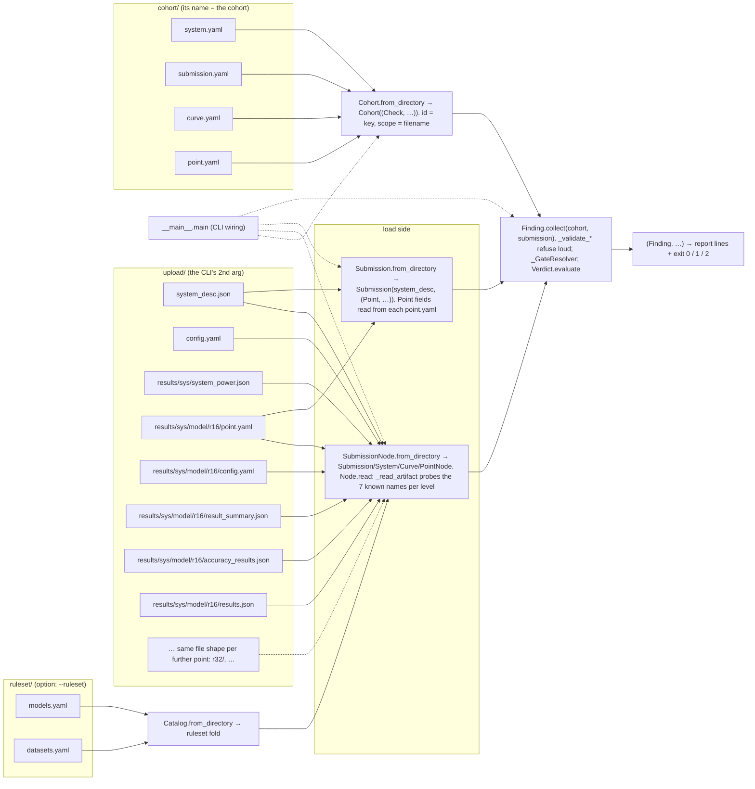

# Validation submodule - implementation notes

"What happens under the hood" for `inference_endpoint.validation`; the
user-facing how-to is [`README.md`](README.md). Content-here is the loader,
row/operator model, tree walk, derivation sources and the runner's mechanics --
for maintainers and reviewers, not check authors.

## Module map

| Module          | Role                                                                                                                                                                                                                                                                                                                                                                                                                                                                                                                                                                                                                                                                                                                                                                                                                                                                                                                                                       |
| --------------- | ---------------------------------------------------------------------------------------------------------------------------------------------------------------------------------------------------------------------------------------------------------------------------------------------------------------------------------------------------------------------------------------------------------------------------------------------------------------------------------------------------------------------------------------------------------------------------------------------------------------------------------------------------------------------------------------------------------------------------------------------------------------------------------------------------------------------------------------------------------------------------------------------------------------------------------------------------------- |
| `__main__.py`   | The user-facing CLI: `main(argv) -> exit code` (argparse), wiring `Cohort.from_directory` + `Submission.from_directory` + `Finding.collect`; `--ruleset DIR` attaches the `Catalog` fold, `--audit` prints holds too; exit `0` holds / `1` failing findings / `2` refused-loud.                                                                                                                                                                                                                                                                                                                                                                                                                                                                                                                                                                                                                                                                            |
| `check.py`      | `Check` (the block's typed shape: `id`/`scope` synthesized from the scope file + mapping key; `description`/`rule`/`severity`/`fix: str\|None`/`needs`/`when`/`assert`; `_decode_row` picks `Compare` vs `Aggregate` by `measure` presence), `Cohort.from_directory` (the four scope files `system.yaml`/`submission.yaml`/`curve.yaml`/`point.yaml`, each an id-keyed mapping; a stray file, an in-body `id`/`scope` or a duplicate `id` -> `ValueError`), `Severity` wire-enum (Values `warn`/`fail`).                                                                                                                                                                                                                                                                                                                                                                                                                                                   |
| `compare.py`    | `Ref` (dotted-fact resolution with `ROOTS` = `submission`/`system`/`curve`/`point`/`derived`/`ruleset`/`regions`; `found`/`MISSING` grid: absent-vs-stored-null distinguished), `Compare` (op row model, `Op`-driven arity), `Aggregate` (collection row with `__new__` measure-dispatch; `Count`/`Sum`/`Mean`/`Min`/`Max`/`AnyTrue`/`AllTrue` family), `Verdict.evaluate` (boundary: `TypeError` -> `incommensurable pair`, `ValueError`/`OverflowError` -> `row failed to evaluate`, all failing verdicts naming both sides; anything else propagates).                                                                                                                                                                                                                                                                                                                                                                                                  |
| `operations.py` | The `Op` family (13 ops) with `__new__` self-registration on `Op(name)` (`Eq`, `Ne`, `Gt`, `Ge`, `Lt`, `Le`, `In`, `Matches`, `SameMultiset`, `Between`, `Exists`, `Absent`, `NotNull`); `Predicate(subject, target)` (`target` can be an `Interval`/`Regions`); `Interval` (bounded/unbounded/half-open range with `__contains__`), `Op.tolerant` ClassVar (True on `Eq`/`Ne` only; `Compare._check_shape` rejects nonzero tolerances on non-tolerant ops).                                                                                                                                                                                                                                                                                                                                                                                                                                                                                               |
| `ranges.py`     | `Interval(lo, hi=None, lo_inclusive, hi_inclusive)`; `Interval.for_accuracy_gate(reference_score, tolerance)` (Section 2.9.8's `score >= factor x reference`).                                                                                                                                                                                                                                                                                                                                                                                                                                                                                                                                                                                                                                                                                                                                                                                             |
| `regions.py`    | `RegionKind` wire-enum (five `compute_regions` keys: `low_latency`/`low_concurrency`/`med_concurrency`/`high_concurrency`/`margin`); `Regions.for_bounds` (Section 5.5's reference algorithm verbatim); `Regions.for_submission` (Section-verified `max_supported_concurrency` + minimum-`concurrency` `C_min` derivation); `Regions.covers` / `Regions.coverage`; Section 5.4 Example C's two hand-typo slips noted inline (port uses the formula both times).                                                                                                                                                                                                                                                                                                                                                                                                                                                                                            |
| `tree.py`       | `Node` (kind-registered subclasses via `__init_subclass__(kind=...)` + `__new__` dispatch: `SubmissionNode`/`SystemNode`/`CurveNode`/`PointNode`); `_StrictLoader` (duplicate-keys/merge-keys/aliases -> parse error); `_read_artifact` (single bounded symlink-safe byte channel: fd-anchored per node dir, `O_NONBLOCK` + `S_ISREG` refuse FIFO/socket/device artifacts instantly, byte-cap before decode, `UnicodeDecodeError` funneled to `(value, error)`, and an empty or non-mapping document reads as `(None, "<name> parse error: ...")`); `Node.scopes()` (facts-projection map).                                                                                                                                                                                                                                                                                                                                                                |
| `sentinels.py`  | The shared `MISSING` sentinel (`value is MISSING` = the fact's absence).                                                                                                                                                                                                                                                                                                                                                                                                                                                                                                                                                                                                                                                                                                                                                                                                                                                                                   |
| `catalog.py`    | `Catalog.from_directory` (ruleset `models.yaml`/`datasets.yaml` -> plain dicts; `Catalog.scopes()` = the `ruleset` root's payload).                                                                                                                                                                                                                                                                                                                                                                                                                                                                                                                                                                                                                                                                                                                                                                                                                        |
| `submission.py` | `normalize_offline` (§8.3's three-state `offline` normalization); `Point` (frozen: `offline`/`concurrency`/`system_tps`/`node` + `point_power_kw` derivation = `provisioned_power_kw x Y/N`, Section 4.5.2/4.5.3, 2dp-rounded-once); `Submission` (frozen `system_desc` + ordered `points`; `Submission.from_directory(root, ruleset=...)` builds one from the upload tree (`system_desc.json` + per-`r<N>` `point.yaml` carrying `concurrency`/`offline`/`system_tps`), latching the derived `regions` fold on the tree root; `offline_ordering` = Section 5.7.2's two clauses with `None`-when-`elected`/agentic; `point_cap` = Section 5.6's `<=32`; `point_count_min` = Section 5.3's `8`-or-`7`; `accuracy_run_count_requirement` = Section 4.3's `5`/`4`; `out_of_range_points` = Section 5.4's Concurrency-in-range row; `derived()` = the lazy `derived.<name>` facts-projection; `_validate_shape` refuses shapes the derivations would trip on). |
| `runner.py`     | `Finding` (audit-trail record: `check_id`/`severity`/`scope`/`node_directory`/`verdict`/`rule`), `Finding.collect` (3 phases: `_validate_*` contracts refuse an unwalkable/unreadable/disagreeing/fold-less submission; `_collect_candidates` validates `needs` names and refuses cycles at load; `_GateResolver` resolves each `needs` chain per node into `_CheckState`; then `_row_findings` emits one `Finding` per `assert` row at each `when`-applicable node whose chain vouches -- holds and failures alike).                                                                                                                                                                                                                                                                                                                                                                                                                                      |

## Row-operator mechanics

`Op` self-registers via
`__init_subclass__(name=..., slots=..., needs_found=..., tolerant=...)` and
dispatches through `Op(name)` (like `Node`'s kind dispatch). Arity per op lives
in one place (`Op.slots`); `Compare._check_shape` validates `Compare`'s
`right`/`lo`/`hi` field-presence against `Op.slots` (so `right: null` remains a
legal eq-against-null operand, per the W1 absent-vs-null grid).
`Predicate(subject, target)` is the resolved-operand carrier; `target` widens to
an `Interval` for `between` (whose `slots` are `("lo", "hi")` -- the only
interval-bound consumer). Region membership is an `op: in` row against
`regions.by_kind.<kind>` (the shipped stub's shape).

`_close_to` compares integer pairs exactly, tolerances honored in integer
arithmetic (math.isclose's float coercion conflates distinct large integers),
and lands float tolerance math only for `eq`/`ne` per `Op.tolerant`. Order ops
(`gt`/`ge`/`lt`/`le`) have no tolerance semantics (no standard meaning of an
ordered comparison under `abs_tol`).

## Library entry (what `__main__.py` calls)

```python
from inference_endpoint.validation.check import Cohort
from inference_endpoint.validation.runner import Finding
from inference_endpoint.validation.submission import Submission

cohort = Cohort.from_directory(Path("my_cohort"))
submission = Submission.from_directory(Path("upload"))
findings = Finding.collect(cohort, submission)
```

`Submission.from_directory` reads the same artifacts the rows read
(`system_desc.json`; per `r<N>`, `point.yaml`'s `concurrency`/`offline`/
`system_tps`) and latches the derived `regions` fold onto the tree's root, so
`_validate_agreement` holds by construction on this path (it guards hand-built
`Submission`s). `SubmissionNode.from_directory(root, ruleset=..., regions=...)`
stays the raw tree entry for tests and rule authors.

## Data flow

One CLI run: every file below is its own node, flowing through the code objects
in the map above to the report. Rendered natively by GitHub, Typora and VS Code.



## Runner's cascade and emission

`Finding.collect(cohort, submission)`:

1. `_validate_points`/`_validate_artifacts`/`_validate_agreement`/
   `_validate_fold_needs` fail loud where the walk cannot happen (no points, or
   a point without its node), where an artifact failed to parse (a corrupt file
   must never read as an absent fact and switch checks off), where a
   hand-carried `Point` fact disagrees with its `point.yaml`, or where the
   cohort names a fold (`regions`/`ruleset` roots or a region-dependent
   derivation) the tree was built without -- silence must never be the verdict.
   A `when` row that failed to evaluate is refused loudly for the same reason
   (`Verdict.broken` separates "judged False" from "could not be judged").
2. `_collect_candidates(cohort)` validates `needs` id references against the
   cohort and `_raise_on_needs_cycles` refuses a `needs` cycle outright -- both
   load-level mistakes, identical for every submission (the walk below never
   decides differently by data).
3. `_GateResolver` resolves every check's `needs` chain at each node into one
   `_CheckState`: `HOLDS` (its `when` applied there, its own chains vouched,
   every `assert` row held), `FAILS` (it ran there and a row failed),
   `NOT_APPLICABLE` (`when` excluded the node -- it makes no claim there),
   `SILENCED` (its own chain refused it). A chain resolves same-or-ancestor
   scopes up the dependent node's chain and finer scopes over every such node in
   its subtree; an upstream **vouches** when it claims at least one of those
   nodes and `HOLDS` at each. So a `when`-gated upstream speaks for what it
   covers and is silent, not damning, elsewhere; one failing claim disavows the
   dependent there; and an empty claim set never vouches -- an unverified
   premise never passes a dependent.
4. Emission: one `Finding` per `assert` row at each `when`-applicable node whose
   chain `HOLDS` (holds and failures alike -- the report side filters
   `not verdict.ok` for a failure summary). A check's own failing rows never
   gate its own Findings; only its dependents stay silent, per node.

## Derivation formulas (verbatim-anchored)

| Named derivation                                                               | Formula / rule source                                                                                                                                                                                                                                                                    |
| ------------------------------------------------------------------------------ | ---------------------------------------------------------------------------------------------------------------------------------------------------------------------------------------------------------------------------------------------------------------------------------------- |
| `Interval.for_accuracy_gate(reference_score, tolerance)`                       | `[tolerance * reference_score, inf)`, Endpoints Policy Section 2.9.8                                                                                                                                                                                                                     |
| `Regions.for_bounds(c_max, c_min)`                                             | Section 5.5's `compute_regions` reference algorithm (verbatim; Section 5.4 Example C's two hand-typo slips noted inline)                                                                                                                                                                 |
| `Regions.for_submission(system_desc, concurrencies)`                           | `C_max = system_desc["max_supported_concurrency"]` (field name verbatim, `endpoints_rules.md`'s Max-concurrency-declared row); `C_min` = `min(concurrencies)`, Section 5.5's "C_min is derived from the submission points" (Section 5.4 Example C's own set carries two points under 32) |
| `Submission.offline_ordering()`                                                | `system_tps(Offline) >= 0.98 * system_tps(C_max)` AND `concurrency(Offline) >= C_max`, Section 5.7.2's two-clause wording; `None`-when-`elected`-or-agentic                                                                                                                              |
| `Submission.point_cap()`                                                       | `len(points) <= 32` (Offline counted), Section 5.6                                                                                                                                                                                                                                       |
| `Submission.point_count_min()`                                                 | `8` if a dedicated `offline` is declared (non-agentic), `7` otherwise (elected-or-agentic), Section 5.3 + `:1292`'s one-fewer-distinct-run derivation                                                                                                                                    |
| `Submission.accuracy_run_count_requirement()`                                  | `5` if any `offline` is declared (non-agentic), `4` otherwise (agentic), Endpoints Policy Section 4.3's `N`                                                                                                                                                                              |
| `Submission.out_of_range_points(regions)`                                      | `tuple(p for p in points if p.concurrency not in regions.coverage())`, Section 5.4's Concurrency-in-range row                                                                                                                                                                            |
| `Point.point_power_kw(provisioned_power_kw, engaged_nodes, provisioned_nodes)` | `round(provisioned_power_kw * engaged_nodes / provisioned_nodes, 2)`, Section 4.5.2/4.5.3's `P_prov x Y/N`, rounded-2dp-once per `:897` (verified against Appendix C's `152.10 x 16/18 = 135.2` and `152.10 x 18/18 = 152.1` golden rows)                                                |

## Known boundaries (deliberate, priced)

- **One regions fold per submission** (root-global): `Regions.for_submission`
  computes from one `system_desc` and the submission-wide minimum concurrency,
  so two curves with differently-derived `C_min`s share one fold. Per-curve
  ownership is the fix; it needs the fold's inputs re-homed (the curve's points)
  and is deferred with the rows that would consume it.
- **`Point` and the tree are two views of one upload**: rows read the parsed
  artifacts, derivations read the typed `Point`s. `Submission.from_directory`
  derives both views from one channel (`system_desc.json` + `<r<N>>/point.yaml`)
  so they agree by construction there; `_validate_agreement` covers
  `concurrency`/`offline` for hand-built `Submission`s. `system_tps` has that
  one `point.yaml` source and no second source to disagree with. The durable fix
  is the single-projection tree commit (typed points derived from the parsed
  tree) together with the fuller `Point` carry.
- **Agentic shape is inferred from omission**: with no `offline` declaration,
  `point_count_min`/`accuracy_run_count_requirement` report the agentic 7/4. A
  non-agentic upload that forgot its declaration is indistinguishable from an
  agentic one at this layer.

## Notable engineering calls (for reviewers)

- Exposure price (charter boundary rule item 1): the `derived.<name>` vocabulary
  is exactly `offline_ordering`, `point_cap`, `point_count_min`,
  `accuracy_run_count_requirement`, `out_of_range_points` (the
  `_DERIVATION_METHODS` and `REGION_DERIVATION_METHODS` tables). The named
  methods `Point.point_power_kw` and `Interval.for_accuracy_gate` stay
  **method-only** -- their inputs (provisioned/engaged node counts; the
  per-model reference score and gate factor) ride no artifact the tree carries
  today, so they price into the PR-2 rows that need them (the per-point
  denominator and accuracy-gate rows) together with the carries those rows
  bring. `Regions.covers`' row use is `regions.by_kind.<kind>` membership
  (`op: in`), the shipped stub's own shape.

- The `strict loader` refuses duplicate keys, `<<` merge keys and all YAML
  aliases (alias fan-out can re-walk shared subtrees exponentially; silent
  last-wins keys hide data from the review).
- `_read_artifact` is fd-anchored: the node's directory opens
  `O_NOFOLLOW|O_DIRECTORY` and the artifact opens by name relative to that fd
  with `O_NOFOLLOW|O_NONBLOCK`, so neither a symlinked artifact (in-tree or out)
  nor a swapped name can redirect a read, and a FIFO/socket/device at an
  artifact name is refused instantly (`S_ISREG` gate: "not a regular file")
  instead of blocking on open. The bounded byte-read runs its cap **before**
  decode and funnels `UnicodeDecodeError` (a `ValueError`) alongside `OSError`
  into `(value, error)` -- one channel where "nothing here aborts the run" holds
  for real. An empty document or a non-mapping root is refused in the same shape
  ("<name> parse error: ..."), so neither can read as an absent fact. Known
  residual: the walk traverses paths, not fds, end to end, so swapping an
  intermediate directory between traversal and the fd open is still a narrow
  race; `matches` patterns are compile-vetted literals at load, so a
  deliberately pathological authored pattern remains cohort-review surface, not
  upload surface.
- `Verdict.evaluate` classifies what escapes a row's `_outcome`: a `TypeError`
  (a genuinely incommensurable pair) becomes an `incommensurable pair` failing
  verdict naming both sides and the exception class; a deliberate `ValueError`
  fail-loud or an `OverflowError` becomes `row failed to evaluate` carrying its
  own message -- never mislabelled as a type mismatch. The shape errors the
  derivations would trip over never reach here at all
  (`Submission._validate_shape` refuses them at build).
- One `MISSING` sentinel (`sentinels.py`) is shared by `Node.read`, `Predicate`
  and the presence ops so the absent-vs-stored-null grid is one rule, not a
  per-module pair of conventions.
- Operand decode (`compare._decode_operand`) keeps the scalar rule
  (root-prefixed dotted string = `Ref`) and offers two explicit forms beside it:
  a root-headed list of raw segments addresses keys that themselves contain
  dots, and `{"literal": ...}` forces a root-looking string. A dotted scalar
  whose head is one edit from a root raises at load, so a typo'd root is never
  silently a literal.
